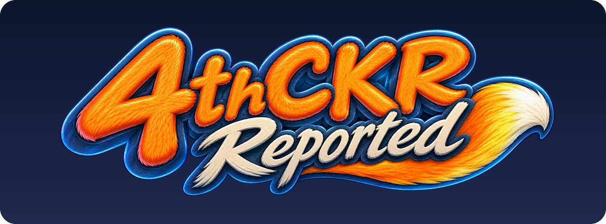
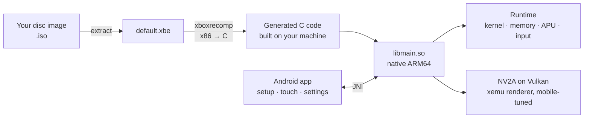

<p align="center">
  
</p>

<p align="center">
  <b>Conker: Live and Reloaded (original Xbox) running natively on Android — through static recompilation.</b>
</p>

<p align="center">
  
  
  
  
  
  
</p>

---

> [!IMPORTANT]
> **No game content is included — and none ever will be.** This repository contains only the
> port itself: the Android app, the runtime, the GPU renderer, build scripts and tools.
> It contains no code, data, graphics, audio or text from the game and nothing made by
> Microsoft or Rare. To build and play you need **your own original disc image** of
> *Conker: Live and Reloaded* for the original Xbox. The game's code is recompiled on your
> machine from your copy; the resulting APK contains that code and must not be redistributed.

## What is it

**4thCKR** turns the original Xbox version of *Conker: Live and Reloaded* into an Android app.
The game's x86 code is translated ahead of time into C and compiled for ARM64, the Xbox kernel
and hardware are provided by a runtime, and the NV2A GPU is rendered with Vulkan. Around it
sits a phone-friendly app: an import screen for your disc image, touch controls, settings and
GPU driver management.

## Features

| | |
|---|---|
| 📀 **Bring your own game** | First launch asks for your disc image (`.iso`). The original English release and the Russian fan translation are recognised; the game data is unpacked once into the app. |
| 🎮 **Controls** | On-screen Xbox controller; Bluetooth / USB gamepads work out of the box. |
| 🖼️ **Display** | Internal resolution ×1 (640×480) or ×2 (1280×960), widescreen or original 4:3, adjustable sharpness, optional FXAA. |
| 🎬 **Movies** | The game's XMV videos are decoded natively (trimmed FFmpeg build). |
| 🔊 **Audio** | MCPX APU / DirectSound emulation with low-latency Android audio output. |
| 🧩 **GPU drivers** | A built-in Turnip (Mesa) driver is used on Snapdragon devices, with automatic fallback to the system driver; custom driver packages can be installed from the settings. |
| ⚡ **Performance** | Vulkan commands recorded on a separate thread, asynchronous shader compilation with a persistent cache, pipeline prewarming during loading screens, caches for vertex data and shader parameters, dynamic CPU core selection under thermal throttling. |
| ⏱️ **Frame rate** | Locked 30 FPS, as on the console. 40 / 60 FPS modes exist as a developer option (parts of the game logic still run too fast above 30). |

## How it works



1. **Recompilation.** [xboxrecomp](https://github.com/sp00nznet/xboxrecomp) analyses `default.xbe`
   and translates every function into C. A small post-processing step
   (`conker/tools/patch_gen.py`) applies the port's edits, described by function address only.
2. **Runtime.** The xboxrecomp runtime provides the Xbox kernel, memory layout, file system,
   timers and input; this port adds an Android/bionic platform layer, the APU, USB and
   networking pieces the game needs.
3. **Graphics.** The NV2A GPU is emulated with the Vulkan renderer from
   [xemu](https://github.com/xemu-project/xemu), adapted for phones: tile-friendly render
   passes, threaded command recording, async pipelines and shaders, Mali and Adreno fixes.
4. **Android app.** Disc image import, SDL activity, touch controller, settings panel and
   GPU driver handling.

## Building

Requirements: Linux or macOS, Android SDK with **NDK 28.0.13004108** and **CMake 3.31.6**,
JDK 17+, Python 3.10+ with `capstone` (`pip install capstone`), git, curl, and a tool to
extract the disc image ([extract-xiso](https://github.com/XboxDev/extract-xiso) or
[xdvdfs](https://github.com/antangelo/xdvdfs)).

```bash
git clone https://github.com/Igggy-code/4thCKR.git
cd 4thCKR

# 1. third-party sources (SDL2, glslang, FFmpeg)
NDK=$ANDROID_HOME/ndk/28.0.13004108 ./scripts/fetch_deps.sh

# 2. extract default.xbe from YOUR disc image and recompile the game code
extract-xiso -x "Conker Live and Reloaded.iso" -d game
./scripts/generate.sh game/default.xbe

# 3. build the APK
ANDROID_HOME=/path/to/android/sdk ./scripts/build.sh
```

Then install `4thCKR.apk`, open it and pick the same disc image when asked.

## Repository layout

| Path | Contents |
|---|---|
| `conker/` | Game-specific code: entry point, hand-written function overrides, movie player, recompiler config, translation tools, post-generation edits |
| `conker-android/` | Android app (Java), Gradle project, native build script |
| `xboxrecomp/` | Static recompilation toolkit and runtime (fork of sp00nznet/xboxrecomp) |
| `nv2a-port/` | NV2A GPU emulation on Vulkan (from xemu) with a small QEMU shim |
| `scripts/` | `fetch_deps.sh`, `generate.sh`, `build.sh` |

## Licenses and credits

The port as a whole is distributed under the **GNU GPL v2 or later** (see `LICENSE`), as it
includes GPL-licensed code from xemu. Components keep their own licenses:

- **xboxrecomp** — MIT, © sp00nz and contributors (`xboxrecomp/LICENSE`)
- **xemu NV2A renderer** — LGPL-2.1+ / GPL-2.0+, © espes, Jannik Vogel, Matt Borgerson and contributors
- **SDL2** — zlib · **glslang** — BSD-3 / Apache-2.0 / MIT · **VulkanMemoryAllocator**, **volk**,
  **SPIRV-Reflect**, **xxHash**, **nv2a_vsh_cpu** — see `nv2a-port/third_party/*`
- **FFmpeg** — LGPL-2.1+ (built from source by `fetch_deps.sh`)
- **libadrenotools** — BSD-2 · **Turnip (Mesa)** — MIT · **PT Sans / PT Serif** fonts — OFL
  (`conker-android/app/src/main/assets/licenses/`)

*Conker: Live and Reloaded* is a trademark of Microsoft Corporation; the game was developed by
Rare. This is an unofficial, non-commercial fan project, not affiliated with or endorsed by
Microsoft or Rare.
